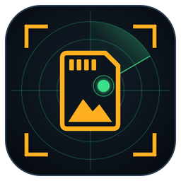
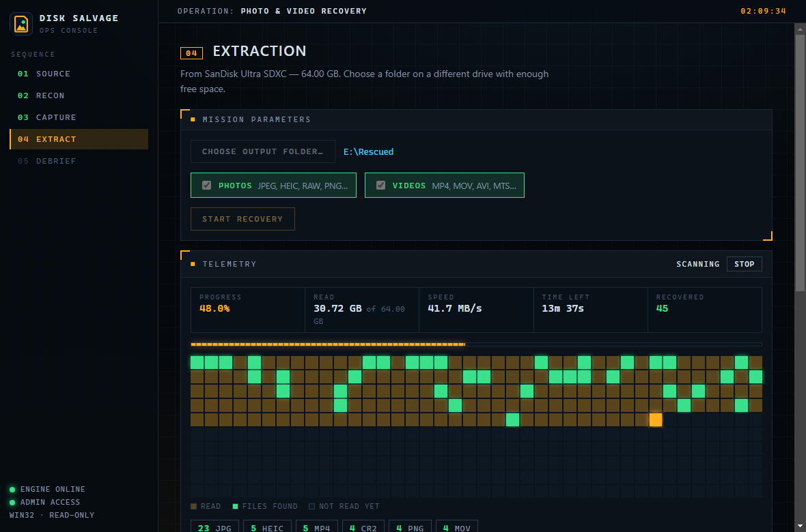
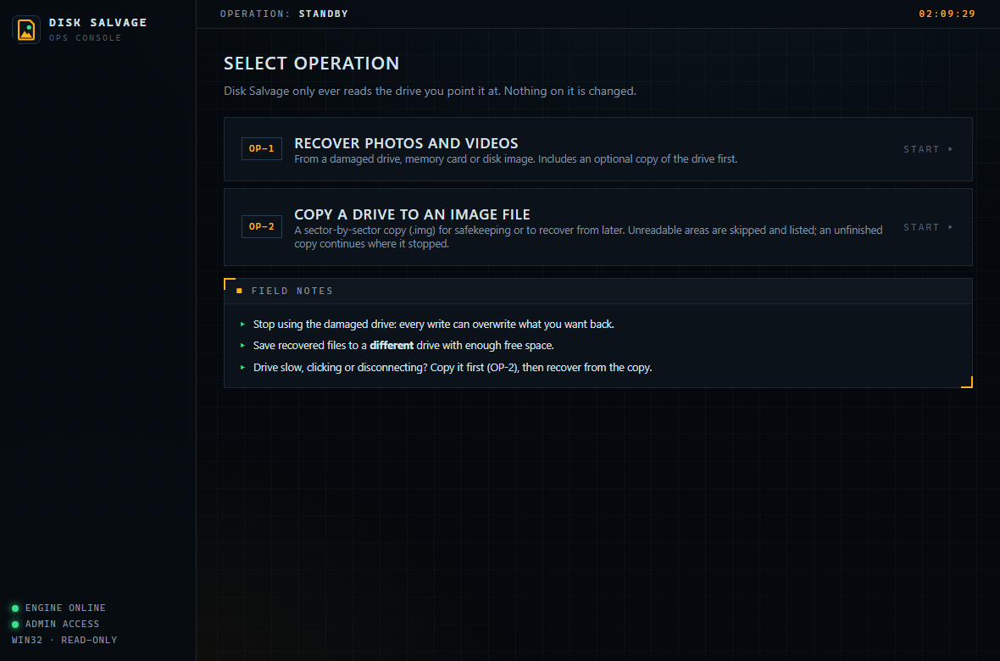
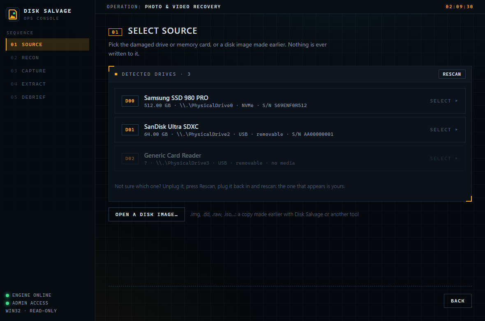
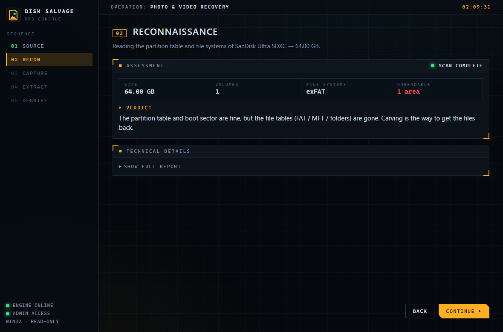
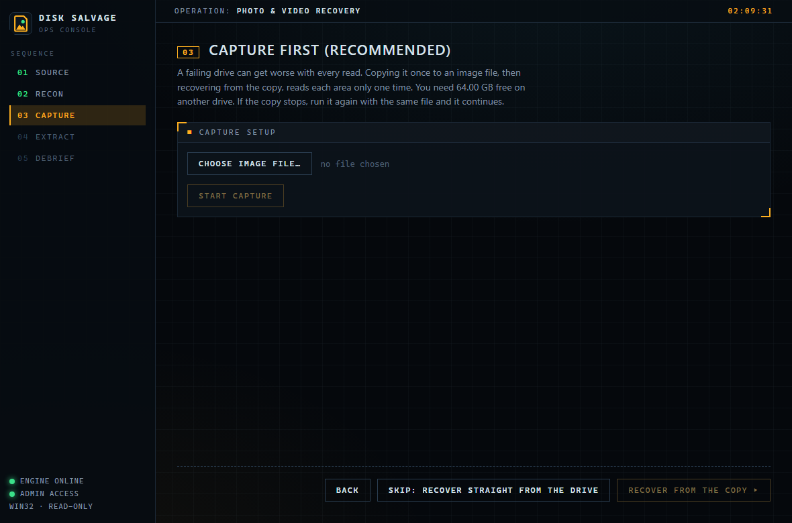
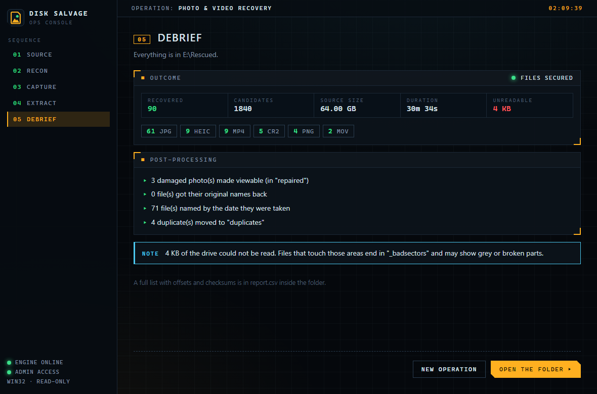
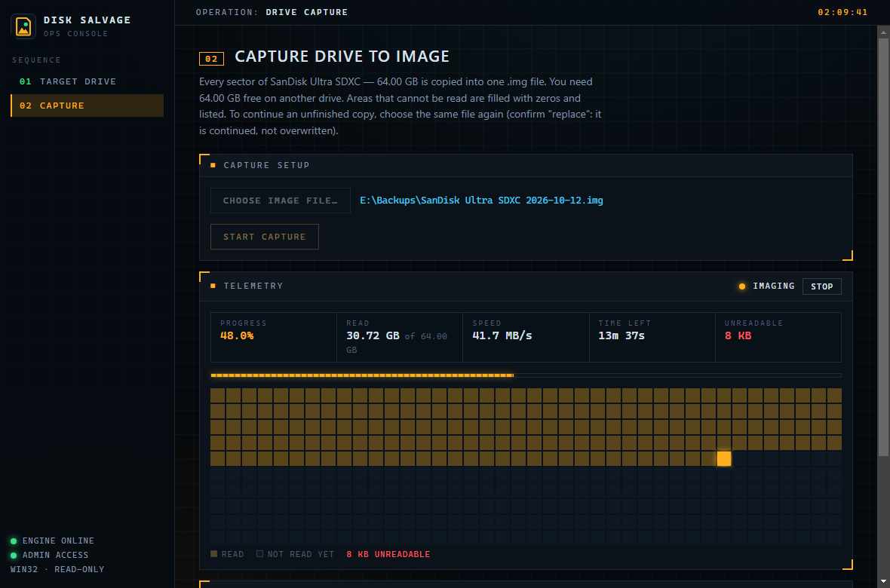
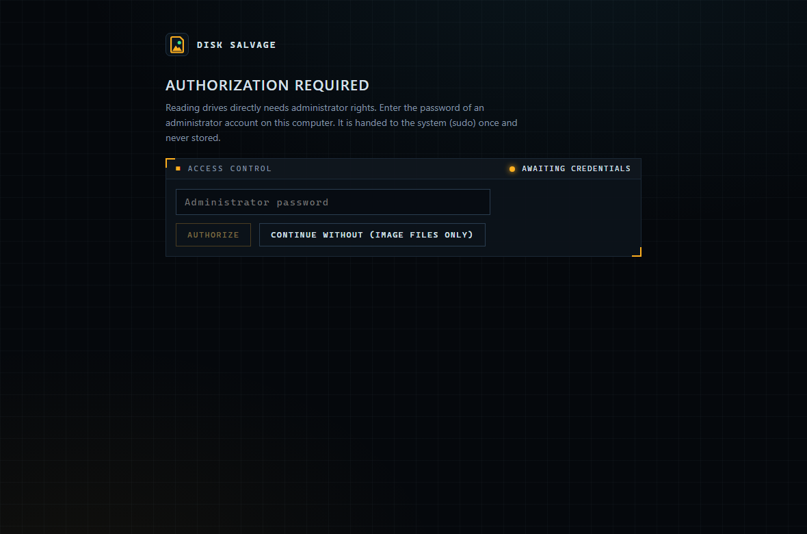

<p align="center">
  
</p>

<h1 align="center">Disk Salvage</h1>

<p align="center">
  <b>Free, open-source photo and video recovery for damaged drives, memory cards and disk images.</b><br>
  Windows · macOS · Linux · MIT licensed
</p>

<p align="center">
  <a href="../../releases/latest">Download</a> ·
  <a href="#step-by-step-recover-photos-and-videos">How to use</a> ·
  <a href="CONTRIBUTING.md">Contribute</a>
</p>

<p align="center">
  
</p>

Disk Salvage searches a drive sector by sector for photos and videos. It finds them even when the
partition table, the file system or the folders are gone. It only ever **reads** the drive it recovers
from, and it is built for drives that are failing: unreadable sectors, USB disconnects, reads that hang.

> [!WARNING]
> **No warranty, no guarantee.** Disk Salvage is provided "as is", without warranty of any kind
> (see [LICENSE](LICENSE)). It does not guarantee that any file can be recovered, that recovered files
> are complete or correct, or that using it will not make a failing drive worse. Every read puts more
> wear on a dying drive. The authors are not liable for any data loss or damage.
>
> **If the data is irreplaceable or valuable, stop and consult a professional data recovery service
> first.** Signs of physical failure include clicking, grinding or beeping, a drive not spinning up,
> a burning smell, or damage from water or a fall. Software, including this one, can make those cases
> worse.

---

## Contents

- [What it can do](#what-it-can-do)
- [Before you start: protect your chances](#before-you-start-protect-your-chances)
- [Install](#install)
- [Step-by-step: recover photos and videos](#step-by-step-recover-photos-and-videos)
- [Step-by-step: copy a drive to an image file](#step-by-step-copy-a-drive-to-an-image-file)
- [Understanding the results](#understanding-the-results)
- [Tips for the best results](#tips-for-the-best-results)
- [Command line](#command-line)
- [Troubleshooting](#troubleshooting)
- [What it cannot do](#what-it-cannot-do)
- [Extending Disk Salvage](#extending-disk-salvage)
- [Building from source](#building-from-source)
- [License](#license)

## What it can do

- **Recovers ~50 photo and video formats** by their internal structure:
  - JPEG (including motion photos), HEIC, AVIF, PNG, GIF, WebP, TIFF, PSD
  - RAW files from Canon, Nikon, Sony, Fuji, Olympus, Panasonic, Pentax and more
  - MP4, MOV, 3GP, AVI, MKV/WebM, MTS/M2TS, MPEG, WMV, FLV and more
- **Works when the file system is broken.** It doesn't matter if the card asks to be formatted, shows as RAW,
  or the partition was deleted.
- **Diagnoses the drive.** It reports the partition table and file systems, gives a plain verdict, and finds
  lost or deleted volumes.
- **Copes with failing hardware:**
  - copies the drive to an image file first, and the copy can be resumed
  - if a USB drive drops out, it waits for you to plug it back in
  - reads that never answer time out
  - unreadable sectors are skipped, filled with zeros and reported
- **Tidies the results:**
  - gives back the **original file names** when FAT folder entries survive (common on camera cards)
  - otherwise names files by the **date the photo or video was taken**
  - makes damaged JPEGs viewable
  - moves duplicates aside
- **Is safe by design:**
  - the source is opened read-only
  - it refuses to save onto the drive you are recovering
  - it stops cleanly when the output drive is nearly full
  - every recovered file is recorded with its position and SHA-256 checksum

## Before you start: protect your chances

Recovered data lives in the parts of the drive that haven't been overwritten yet. So:

1. **Stop using the drive immediately.** Don't save, install, download or "fix" anything on it.
   Don't format it, even if Windows or the camera offers to.
2. **Don't run `chkdsk`, "Repair", First Aid or `fsck`** on it before recovering. They can rewrite the very
   structures that point to your files.
3. **Have another drive ready for the results**, with free space at least as large as what you
   expect to recover. To copy the whole drive first, you need free space equal to the drive's full size.
4. **SSDs:** deleted files on SSDs are often erased within minutes by TRIM. Recovery from SSDs works
   best when the drive failed or was corrupted rather than files deleted. Memory cards, USB sticks and
   hard drives are usually much better candidates.

## Install

Download the latest version from the [**Releases**](../../releases) page:

| System | File | Notes |
|---|---|---|
| Windows 10/11 | `Disk Salvage-Setup-<version>.exe` (installer) or `Disk Salvage-<version>-portable.exe` (no install) | Asks for Administrator rights each time it opens. That is needed to read drives directly. |
| macOS | `Disk Salvage-<version>.dmg` | Asks for your administrator password inside the app. First launch: right-click → **Open** (the app is not code-signed). |
| Linux (Debian, Ubuntu, Mint…) | `disk-salvage_<version>_amd64.deb` | `sudo apt install ./disk-salvage_<version>_amd64.deb`, then start **Disk Salvage** from the app menu. Asks for your sudo password inside the app. |
| Linux (Fedora, RHEL, openSUSE…) | `disk-salvage-<version>.x86_64.rpm` | `sudo dnf install ./disk-salvage-<version>.x86_64.rpm` (openSUSE: `sudo zypper install …`). |
| Linux (any) | `Disk Salvage-<version>.AppImage` | No install: `chmod +x` it, then run it. |

The app includes everything it needs; you don't have to install Python or anything else.

> The builds are not code-signed. Windows SmartScreen may say "Windows protected your PC".
> Click **More info → Run anyway**. Only download Disk Salvage from this repository's Releases page.

If there's no release for your system yet, see [Building from source](#building-from-source).

## Step-by-step: recover photos and videos

1. **Connect the damaged drive or card** (a USB card reader works well) and open Disk Salvage.
   Accept the administrator prompt (Windows) or enter your password (macOS/Linux).
   - Without administrator rights you can still recover from **image files**, just not from drives directly.
2. Choose **Recover photos and videos**.
3. **Source:** pick the drive by its model and size, or **Open a disk image…** if you made a copy earlier.
   - Not sure which drive it is? Unplug it, press **Refresh drives**, plug it back in and refresh again.
     The one that appeared is yours.
4. **Check:** Disk Salvage reads the partition table and file systems and gives a verdict. For example:
   "file tables are gone, carving is the way". **Technical details** shows the full report. Click **Continue**.
5. **Copy (recommended for anything unreliable):** choose where to save an image file of the whole drive,
   then **Start copying**. Recovering from the copy means the weak drive is read only once.
   - You can stop and continue later: choose the same file again.
   - If the drive is healthy and you're in a hurry, **Skip** recovers straight from the drive.
6. **Recover:**
   1. Choose an **output folder on a different drive**.
   2. Tick Photos and/or Videos.
   3. Click **Start recovery** and watch files appear as they are found.
7. **Finish:** see what was found, then **Open the folder**.

How long it takes depends on the drive's size and speed, not on how many files it holds. A 64 GB card over
USB 3 typically takes 10–20 minutes. A large, failing hard drive can take many hours.

<details>
<summary><b>Screenshots</b></summary>

| | |
|---|---|
|  Choose an operation |  Pick the drive |
|  Drive check and verdict |  Optional copy first |
|  Live recovery |  Results |
|  Copy a drive to an image |  macOS/Linux password |

</details>

## Step-by-step: copy a drive to an image file

Use this to make a full backup of a drive or card before anything else happens to it, or to recover from it
later or on another computer.

1. Open Disk Salvage and choose **Copy a drive to an image file**.
2. Pick the drive, then **Choose image file…** on a different drive with enough free space.
3. **Start copying.** Progress, speed and time left are shown, and **Stop** pauses safely.
4. To continue an unfinished copy, pick the same drive and the same file again. Confirm "replace":
   the file is continued, not overwritten.
5. When it's done, **Recover photos from this copy**, or keep the image for later. Keep the small `.map` file
   next to the `.img`. It records which areas could not be read.

## Understanding the results

The output folder contains one sub-folder per file type (`jpg/`, `mp4/`, `heic/`…), plus:

| Item | Meaning |
|---|---|
| `IMG_0042.jpg` | The original name, recovered from a surviving folder entry |
| `2023-07-14_18-22-05.jpg` | Named by the date the photo/video was taken (EXIF / video header) |
| `000123_0x4a2000.jpg` | No name or date found: the number and position on the drive |
| `…_badsectors.jpg` | Part of the file sat on unreadable sectors (filled with zeros): parts may look grey or broken |
| `…_partial.jpg` | The file runs past the end of the drive or image (it may be cut off) |
| `…_approx.mov` | The exact end could not be determined; the file may contain extra data at the end |
| `repaired/` | Viewable versions of damaged JPEGs, cut at the first unreadable area |
| `duplicates/` | Byte-identical copies of files kept elsewhere in the folder |
| `report.csv` | Every file with offset, size, status, SHA-256 and how it was named (opens in Excel) |
| `report.json` | The same, for scripts |

## Tips for the best results

- **Image first** whenever a drive is slow, makes noise, disconnects or shows errors.
  Then disconnect the drive and work from the image.
- **Use a good, direct connection.** Plug into the computer itself, not a hub. A card in a quality USB
  reader is often more reliable than the camera connected by cable.
- **If the drive disconnects during a copy or recovery,** unplug it, wait a few seconds and plug it back in.
  Disk Salvage waits and continues by itself.
- **Keep the computer awake** for long runs (turn sleep off temporarily).
- **Lots of files with no names?** That's normal when the file system was wiped. Date-based names and
  `report.csv` help you sort them.
- **A video won't play?** Try VLC. Videos recorded in pieces (fragmented) can't always be rebuilt by carving.
- **Run it again with other settings** from the command line if needed (e.g. `--align 1` to find files that
  don't start on sector boundaries; slower).

## Command line

The engine also works as a command-line tool. The app bundles it as `salvage-engine`; from source it's
`python -m salvage`.

```
salvage drives                                  # list drives (Administrator / root)
salvage analyze \\.\PhysicalDrive1              # partition + file system report
salvage image \\.\PhysicalDrive1 E:\card.img    # copy a drive (run again to continue)
salvage recover E:\card.img E:\rescued          # recover photos and videos
salvage recover E:\card.img E:\rescued --types jpg,heic,mp4 --dry-run
salvage post E:\rescued --steps dates,dedupe    # re-run tidying steps
salvage --help
```

Drive names look like `\\.\PhysicalDrive1` on Windows, `/dev/sdb` on Linux and `/dev/disk2` on macOS.

## Troubleshooting

| Problem | What to do |
|---|---|
| No drives listed | Run with administrator rights (accept the prompt / enter the password). Check that the drive appears in Disk Management, `lsblk` or Disk Utility. |
| "is on the drive being recovered" | Choose an output folder on a different drive. This is a safety check. |
| "only … free" / recovery stopped early | The output drive is full. Free space or choose a bigger drive, then recover into a new empty folder. |
| Drive keeps disconnecting | Try another cable, port or card reader. Image it first; Disk Salvage resumes after each reconnect. Areas that fail repeatedly are skipped. |
| Copy is extremely slow | The drive is struggling with bad areas. Let it run, or stop and continue later; progress is saved. |
| Very few files found | The data may have been overwritten, encrypted (BitLocker/FileVault) or TRIM-erased (SSD), or the files are heavily fragmented. Try `--align 1` from the command line. |
| macOS: "cannot be opened" | Right-click the app → Open. Reading some drives also needs System Settings → Privacy & Security → Full Disk Access. |

## What it cannot do

- Recover files that have been **overwritten**, or from **encrypted** drives without unlocking them first.
- Rebuild **fragmented** files: files stored in scattered pieces may come out incomplete.
- Recover documents, music or other file types (photos and videos only for now).
- Restore full folder structures (original names are restored where possible; folders are not).
- Fix **physical** damage. That needs a clean-room recovery lab.

## Extending Disk Salvage

Contributions are welcome; see [CONTRIBUTING.md](CONTRIBUTING.md). The design is meant to be extended
without touching the core:

- **New file format:** write one parse function in `engine/salvage/formats/` and decorate it with
  `@register(...)`. The scanner and carver pick it up automatically.
- **New tidying step:** implement the small `PostStep` protocol in `engine/salvage/post/` and add it to `STEPS`.
- **New front end:** the engine speaks JSON lines over stdin/stdout (`salvage serve`), so any UI or script
  can drive it.

```
engine/   Python package "salvage" (standard library only)
  sources.py      read-only byte sources: image file, raw device (bad sectors, reconnect, timeouts), memory
  devices/        Windows / Linux / macOS drive listing and raw access
  formats/        one parser per format, registered with @register
  carving/        signature scanner, carver, output writer
  fs/             MBR/GPT, FAT/exFAT/NTFS probes, FAT folder scanner, lost-volume search
  imaging.py      resumable drive -> image copy
  post/           PartialPhotos, OriginalNames, DateNames, Dedupe
  service.py      the use cases; the CLI and the server only call this
  cli.py          command line
  server.py       JSON-lines server for the app
  tests/          includes simulated failing drives (bad sectors, dropouts, hangs)
app/      Electron + React + TypeScript desktop app
  electron/       main process, engine client, preload bridge
  src/            the wizard UI
```

### Engine protocol

```
→ {"id": 7, "method": "recover", "params": {"source": "card.img", "out_dir": "E:/rescued"}}
← {"event": "progress", "job": 7, "data": {"phase": "scanning", "done": 1048576, "total": 8589934592}}
← {"event": "file", "job": 7, "data": {"ext": "jpg", "path": "jpg/IMG_0042.jpg", "status": "ok"}}
← {"id": 7, "result": {"saved": 812, "stats": {"jpg": 790, "mp4": 22}}}
```

Methods: `version`, `list_drives`, `analyze`, `image`, `recover`, `postprocess`, and `cancel` (`{"job": 7}`).
Errors come back as `{"id": 7, "error": {"type": "...", "message": "..."}}`.

## Building from source

Requirements: Python 3.10+ and Node.js 22.

```
# engine only (command line)
cd engine
pip install -e ".[dev]"
pytest
python -m salvage --help

# desktop app, development
cd app
npm install
npm start

# installers for the current OS (-> app/release/)
pip install pyinstaller
cd app && npm run dist
```

GitHub Actions runs the tests on Windows, macOS and Linux (`.github/workflows/ci.yml`) and can build the
installers for all three (`.github/workflows/release.yml`: it runs when a release is published and attaches
the files to it, or run it by hand from the Actions tab).

## License

[MIT](LICENSE): free to use, copy, modify and distribute, including commercially. Provided **as is, without
warranty or guarantee of any kind**.
